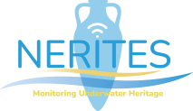

# Nerites Underwater Simulator

## Motivation

The **Nerites Underwater Simulator** is a ROS 2 Foxy–based simulation framework for Autonomous Underwater Vehicles (AUVs), Remotely Operated Vehicles (ROVs), underwater manipulators, and reinforcement learning environments.  

It extends the UUV Simulator ecosystem with new vehicles, controllers, sonar models, and training tools, enabling:

* Autonomous underwater robotics research  
* Control and thrust allocation testing  
* Manipulation tasks using Oberon4/Oberon7  
* Reinforcement learning in realistic ocean environments  
* Multi-vehicle simulation  

<p align="center">
  
</p>

---

## Features

### Underwater Worlds

Nerites includes all underwater environments from the UUV Simulator:

* Ocean worlds  
* Pool/tank environments  
* Hydrodynamic & buoyancy models  
* Current, turbidity and noise plugins  
* Structured testing environments  

---

### Supported Vehicles

| Vehicle | Description |
|--------|-------------|
| RexROV | Robust ROV with full thruster configuration |
| RexROV + Oberon4 | ROV with 4-DOF manipulator |
| RexROV + Oberon7 | ROV with 7-DOF manipulator |
| ECA A9 AUV | Torpedo-style autonomous underwater vehicle |
| X300 AUV/ROV | Lightweight, configurable research vehicle |

<p align="center">
  
</p>

All vehicles include hydrodynamic models, sensor suites, ROS 2 interfaces and launch files.

---

### Controllers

Nerites provides:

* NED controller  
* Non-NED controller  
* Velocity, heading and depth controllers  
* Station-keeping controllers  
* Thrust allocation for multi-thruster vehicles  

---

### Sensor Suite

* RGB camera  
* GPU sonar (`gpu_ray` sensor)  
* IMU  
* Depth/pressure sensor  
* DVL emulation  
* ROS 2 LaserScan & CameraInfo publishers  

<p align="center">
  
</p>

---

### Reinforcement Learning Environment

Nerites provides a Gym-style RL interface supporting:

* reset() / step() API  
* Domain randomization (currents, noise, visibility)  
* Hovering tasks  
* Waypoint following tasks  
* Multi-vehicle training  

---

## Requirements

This project requires:

* ROS 2 Foxy  
* Gazebo Classic 11  
* Python ≥ 3.8  
* Colcon build tools  

---

## Installation and Running

### Installation

#### Clone the workspace
```
git clone <your-repo-url> ~/nerites_sim_ws
cd ~/nerites_sim_ws/src
```

#### Install dependencies  
```
rosdep update
rosdep install --from-paths . --ignore-src -y
```

#### Build  
```
cd ~/nerites_sim_ws
colcon build --symlink-install
source install/setup.bash
```

---

### Running the Simulator

#### Launch an underwater world
```
ros2 launch uuv_gazebo_worlds ocean_world.launch.py
```

#### Spawn RexROV
```
ros2 launch rexrov_sim bringup.launch.py
```

#### Spawn RexROV with Oberon7 arm
```
ros2 launch rexrov_sim bringup.launch.py use_arm:=oberon7
```

#### Launch the ECA A9
```
ros2 launch eca_a9_nerites start_eca_a9.launch.py
```

#### Spawn X300
```
ros2 launch x300_description spawn_x300.launch.py
```

---

## Usage

### View camera output
```
rqt_image_view /eca_a9/camera/image
```

### View sonar output
```
rviz2 -d sonar_visualization.rviz
```

---

## Reinforcement Learning Example

```
import gym
import nerites_gym

env = gym.make("NeritesAUVEnv-v0")
obs = env.reset()

for step in range(1000):
    action = policy(obs)
    obs, reward, done, info = env.step(action)
    if done:
        obs = env.reset()
```

<p align="center">
  
</p>

---

## Repository Structure

```
nerites_sim_ws/
└── src/
    ├── Nerites/
    │   ├── uuv_simulator
    │   ├── uuv_descriptions
    │   ├── uuv_gazebo
    │   ├── uuv_gazebo_worlds
    │   ├── uuv_sensor_plugins
    │   ├── uuv_world_plugins
    │   ├── uuv_control
    │   ├── uuv_assistants
    │   ├── uuv_teleop
    │   ├── nerites
    │   └── nerites_utils
    │
    ├── eca_a9_nerites/
    ├── x300_description/
    ├── kdl_parser_py/
    └── ...
```

---

## Contributing

Contributions are welcome.  
You may help with:

* New vehicle models  
* Improved sonar simulation  
* Manipulation extensions  
* RL tasks and benchmarks  
* Documentation and tutorials  

Fork → Branch → Pull Request.

---

## Cite as

```
@misc{nerites2025,
  title  = {Nerites Underwater Simulator},
  author = {Alice S. and Contributors},
  year   = {2025},
  url    = {https://github.com/<your-repo>}
}
```

---

# Final Note

Nerites provides a robust, flexible simulation framework for:

* AUV autonomy  
* ROV manipulation  
* Underwater control systems  
* Reinforcement learning research  

**Nerites gives you the ocean — now go explore it.**
