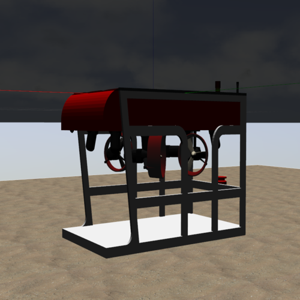
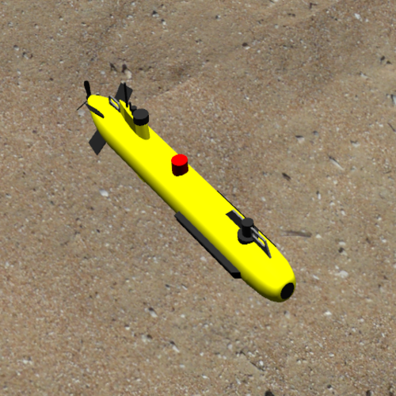
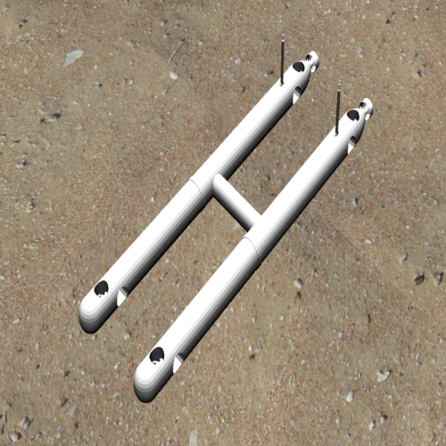
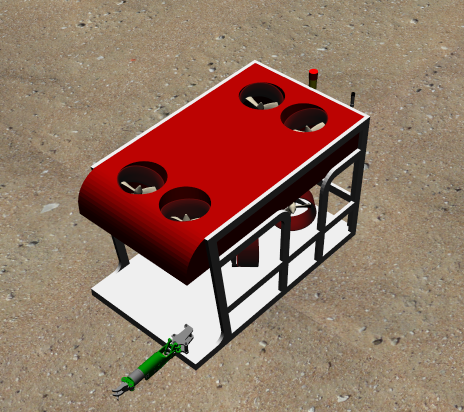
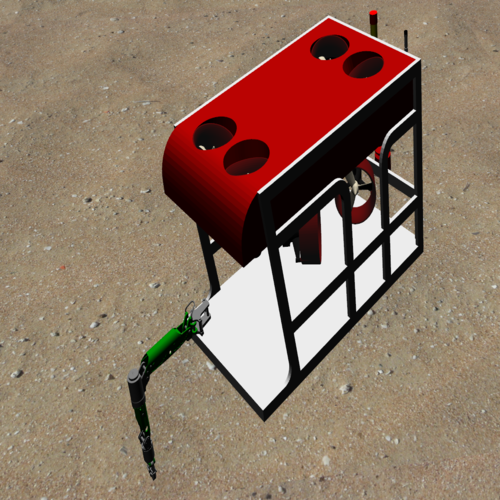
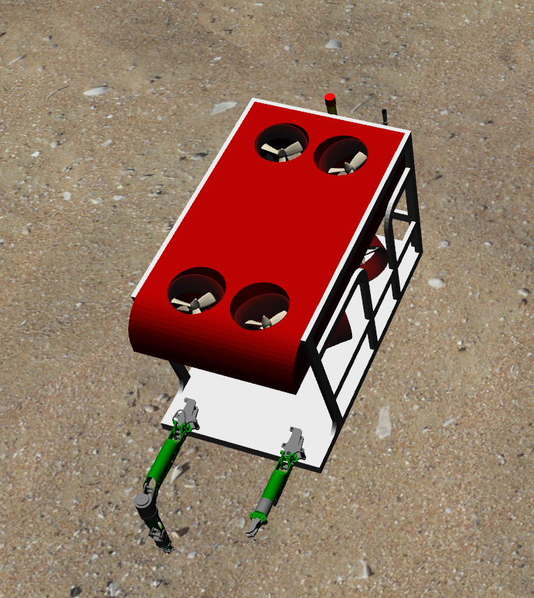
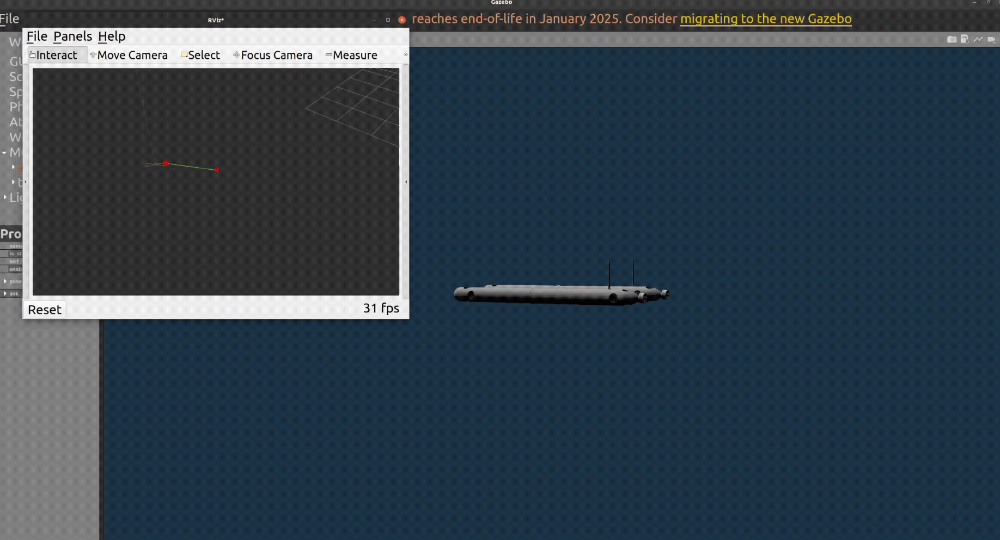

# Nerites Underwater Simulator

ROS 2 Foxy Simulation, Control, and Reinforcement Learning for
Underwater Robotics

------------------------------------------------------------------------

## Motivation

Nerites Underwater Simulator is a complete ROS 2 Foxy port and extension
of the original UUV Simulator framework:\
https://github.com/uuvsimulator/uuv_simulator

The project focuses on:

-   Full ROS 1 to ROS 2 Foxy migration of underwater simulation tools\
-   Support for realistic AUV and ROV vehicle models\
-   Reinforcement learning for underwater control\
-   Underwater manipulation with Oberon robotic arms\
-   Multi-vehicle, sensor-rich simulation environments

------------------------------------------------------------------------

## Included Vehicles

-   RexROV -- Work-class ROV\
-   ECA A9 -- Torpedo-style AUV\
-   GRAALTech X300 -- Hybrid AUV/ROV\
-   Oberon4 and Oberon7 manipulators\
-   Gym-compatible RL framework with Soft Actor--Critic (SAC) training
    pipelines

------------------------------------------------------------------------

## Features

### Underwater Worlds

Nerites ports and extends the original UUV Simulator environments to ROS
2:

-   Ocean environments\
-   Pool and tank setups\
-   Hydrodynamic and buoyancy models\
-   Current, turbidity, and noise plugins\
-   Structured benchmarking environments

------------------------------------------------------------------------

### Supported Vehicle Configurations

  -----------------------------------------------------------------------
  Vehicle                     Description
  --------------------------- -------------------------------------------
  RexROV                      Work-class ROV with full thruster
                              configuration

  ECA A9 AUV                  Torpedo-style autonomous underwater vehicle

  GRAALTech X300              Hybrid AUV/ROV with hovering and profiling
                              capability

  RexROV + Oberon4            ROV with 4-DOF manipulator

  RexROV + Oberon7            ROV with 7-DOF serial arm

  RexROV + Dual Arms          ROV with both Oberon4 and Oberon7
  -----------------------------------------------------------------------
  
  <p align="center">
    
    
    
    
    
    
  </p>
  ------------------------------------------------------------------------

## Manipulators: Oberon4 and Oberon7

  Arm              DOF   Description
  ---------------- ----- --------------------------------------------
  Oberon4          4     ROV-mounted arm with jaw gripper
  Oberon7          7     Serial arm with wrist and parallel gripper
  Dual-arm setup   11    Combined Oberon4 and Oberon7 on RexROV

### Control and Kinematics Support

-   gazebo_ros2_control integration\
-   joint_state_broadcaster\
-   Position and effort controllers\
-   Gripper control (jaw and parallel)\
-   Forward and inverse kinematics services

------------------------------------------------------------------------

## GRAALTech X300 Hybrid AUV/ROV

The GRAALTech X300 is a compact torpedo-shaped hybrid AUV/ROV designed
for:

-   Long-range autonomous navigation\
-   Precision hovering and station-keeping\
-   Environmental monitoring and inspection

In Nerites, X300 is fully modeled in ROS 2 with:

-   Thruster allocation\
-   Hydrodynamic modeling\
-   Sensor integration\
-   A dedicated SAC RL training environment (x300_env.py)

### Simulated Actuation

-   Two rear main thrusters for surge\
-   Four vertical tunnel thrusters for heave\
-   Four horizontal tunnel thrusters for yaw and lateral motion

------------------------------------------------------------------------

## Controllers

### RexROV Trajectory Controllers (Verified in ROS 2 Foxy)

Launch Gazebo world:

``` bash
ros2 launch uuv_gazebo_worlds auv_underwater_world.launch.py
```

Launch RexROV:

``` bash
ros2 launch uuv_descriptions upload_rexrov_default.launch.py
```

Available controllers:

``` bash
ros2 launch uuv_trajectory_control rov_pid_controller.launch.py uuv_name:=rexrov
ros2 launch uuv_trajectory_control rov_mb_fl_controller.launch.py uuv_name:=rexrov
ros2 launch uuv_trajectory_control rov_mb_sm_controller.launch.py uuv_name:=rexrov
ros2 launch uuv_trajectory_control rov_nl_pid_controller.launch.py uuv_name:=rexrov model_name:=rexrov
ros2 launch uuv_trajectory_control rov_pd_grav_compensation_controller.launch.py uuv_name:=rexrov model_name:=rexrov
ros2 launch uuv_trajectory_control rov_sf_controller.launch.py uuv_name:=rexrov
ros2 launch uuv_trajectory_control rov_ua_pid_controller.launch.py uuv_name:=rexrov
ros2 launch uuv_trajectory_control rov_nmb_sm_controller.launch.py uuv_name:=rexrov model_name:=rexrov
```

Send a waypoint file:

``` bash
ros2 launch uuv_control_utils send_waypoints_file.launch.py uuv_name:=rexrov
```

------------------------------------------------------------------------

## Disturbance and Thruster Tutorials

``` bash
ros2 launch uuv_tutorial_disturbances tutorial_disturbance_manager.launch.py
ros2 launch uuv_tutorial_disturbances tutorial_body_wrench.launch.py
ros2 launch uuv_tutorial_disturbances tutorial_thruster_efficiency.launch.py
ros2 launch uuv_tutorial_disturbances tutorial_thruster_state.launch.py
ros2 launch uuv_tutorial_disturbances tutorial_timed_current.launch.py
```

------------------------------------------------------------------------

## Reinforcement Learning Environment

Base environment: - base_env.py\
- reset() and step() API\
- Continuous action spaces\
- Rich observation spaces

Vehicle-specific environments: - RexROV → rexrov_env.py\
- ECA A9 → eca_a9_env.py\
- X300 → x300_env.py

A custom Soft Actor--Critic (SAC) implementation is included for
full-DOF control training.

------------------------------------------------------------------------

## Training SAC Controllers

1.  Select target vehicle: rexrov, eca_a9, or x300

2.  Set configuration path in:

``` python
SETTINGS_PATH = "settings/settings_rexrov.txt"
SETTINGS_PATH = "settings/settings_eca_a9.txt"
SETTINGS_PATH = "settings/settings_x300.txt"
```

3.  Configure:

-   Episode length\
-   Steps per episode\
-   Observation and action scaling\
-   SAC hyperparameters

4.  Run training:

``` bash
python3 custom_algorithms/my_sac_train.py
```

<p align="center">
  
</p>

------------------------------------------------------------------------

## Requirements

-   ROS 2 Foxy\
-   Gazebo Classic 11\
-   Python 3.8 or newer\
-   Colcon build tools

------------------------------------------------------------------------

## Installation

``` bash
git clone <your-repo-url> ~/nerites_sim_ws
cd ~/nerites_sim_ws/src
rosdep update
rosdep install --from-paths . --ignore-src -y
cd ~/nerites_sim_ws
colcon build
source install/setup.bash
```

------------------------------------------------------------------------

## Repository Structure

nerites_sim_ws/ └── src/ ├── Nerites/ │ ├── uuv_simulator │ ├──
uuv_descriptions │ ├── uuv_gazebo │ ├── uuv_gazebo_worlds │ ├──
uuv_sensor_plugins │ ├── uuv_world_plugins │ ├── uuv_control │ ├──
uuv_assistants │ ├── uuv_teleop │ ├── nerites_gym │ └── nerites_utils
├── eca_a9_nerites/ ├── x300_description/ ├── oberon4_control/ ├──
oberon7_control/ ├── kdl_parser_py/

------------------------------------------------------------------------

## Contributing

Contributions are welcome in:

-   New vehicle models\
-   Sonar and sensor simulation\
-   Manipulation and dual-arm coordination\
-   Reinforcement learning benchmarks\
-   Documentation and tutorials

------------------------------------------------------------------------

## Citation

To be announced.

------------------------------------------------------------------------

## Final Note

Nerites is a research-grade ROS 2 Foxy underwater robotics simulation
framework integrating realistic hydrodynamic vehicle models, underwater
manipulation, Gym-compatible reinforcement learning environments, and
Soft Actor--Critic control for full six-degree-of-freedom motion.
